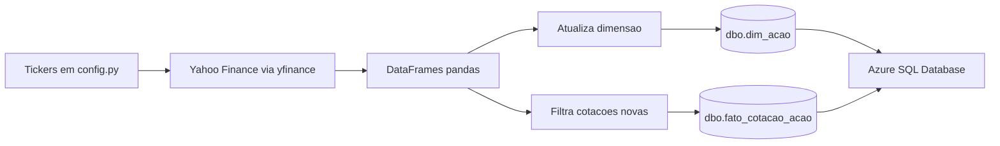

# B3 Lakehouse Project

Pipeline Python para extrair cotacoes recentes de acoes negociadas na B3 pelo Yahoo Finance (`yfinance`) e carrega-las no Azure SQL Database. A persistencia separa os metadados dos ativos das cotacoes e evita inserir novamente uma chave `(ticker, data_referencia)` ja existente.

## Como funciona



1. `main.py` inicia a extracao para os tickers definidos em `config.py`.
2. `extractor.py` baixa os precos dos ultimos cinco dias e consulta os metadados de cada ativo.
3. `database.py` insere na dimensao apenas tickers que ainda nao existem.
4. As cotacoes sao comparadas com as chaves existentes na tabela fato; apenas as novas sao inseridas.

## Estrutura

```text
b3-lakehouse-project/
├── config.py          # Variaveis de ambiente e tickers monitorados
├── database.py        # Conexao e persistencia no Azure SQL
├── extractor.py       # Extracao e normalizacao via yfinance
├── main.py            # Orquestracao do pipeline
├── requirements.txt   # Dependencias Python fixadas
└── README.md
```

## Requisitos

- Python 3.10 ou superior.
- Azure SQL Database acessivel com permissao de leitura e escrita no schema `dbo`.
- ODBC Driver 17 for SQL Server instalado.
- As tabelas `dbo.dim_acao` e `dbo.fato_cotacao_acao` devem existir antes da execucao.

O repositorio nao inclui scripts DDL. O contrato de colunas esperado esta descrito abaixo.

## Configuracao

Crie um arquivo `.env` na raiz do projeto e mantenha credenciais fora do controle de versao:

```env
AZURE_SQL_SERVER=seu-servidor.database.windows.net
AZURE_SQL_DATABASE=nome-do-banco
AZURE_SQL_USER=seu-usuario
AZURE_SQL_PASSWORD=sua-senha
```

Os tickers configurados atualmente sao `PETR4.SA`, `VALE3.SA`, `ITUB4.SA`, `BBDC4.SA` e `ABEV3.SA`. Altere a lista `TICKERS_B3` em `config.py` para incluir ou remover ativos. Use o sufixo `.SA` aceito pelo Yahoo Finance.

## Tabelas esperadas

### `dbo.dim_acao`

| Coluna | Descricao |
| --- | --- |
| `ticker` | Simbolo do ativo, por exemplo `PETR4.SA` |
| `nome_empresa` | Nome longo, nome curto ou ticker como fallback |
| `setor` | Setor informado pelo provedor |
| `industria` | Industria informada pelo provedor |
| `moeda` | Moeda informada pelo provedor; usa `BRL` como fallback |

### `dbo.fato_cotacao_acao`

| Coluna | Descricao |
| --- | --- |
| `ticker` | Simbolo do ativo |
| `preco_abertura` | Preco de abertura |
| `preco_fechamento` | Preco de fechamento |
| `preco_maximo` | Maior preco do dia |
| `preco_minimo` | Menor preco do dia |
| `volume_negociado` | Volume negociado |
| `data_referencia` | Data da cotacao, no formato `YYYY-MM-DD` |

Uma restricao ou indice unico em `(ticker, data_referencia)` na tabela fato e recomendado para reforcar a idempotencia no banco.

## Instalacao e execucao

No PowerShell, a partir da pasta do projeto:

```powershell
python -m venv venv
.\venv\Scripts\Activate.ps1
pip install -r requirements.txt
python main.py
```

O pipeline imprime o andamento da extracao e da carga no terminal. A janela de extracao e definida como `5d` em `main.py`.

## Comportamento e limitacoes

- Os metadados da dimensao sao inseridos apenas para tickers novos; os dados de um ticker existente nao sao atualizados.
- A carga da tabela fato e incremental por `(ticker, data_referencia)`. Uma cotacao ja existente nao e atualizada se o provedor corrigir seus valores posteriormente.
- Falhas ao processar um ticker sao reportadas e a extracao tenta continuar com os demais.
- Se a extracao retornar uma das tabelas vazia, `main.py` encerra a execucao sem carregar nenhuma delas.
- O tratamento de erro principal apenas imprime a excecao; a execucao pode terminar sem codigo de saida diferente de zero mesmo quando o pipeline falha.
- As tabelas sao pre-requisitos: este projeto nao cria nem versiona o schema SQL.

## Tecnologias

- Python 3.10+
- `pandas` e `yfinance`
- `SQLAlchemy` e `pyodbc`
- Azure SQL Database

Os dados dependem da disponibilidade e qualidade do Yahoo Finance. O projeto tem finalidade educacional e de portfolio; valide os requisitos de uso e licenciamento antes de utiliza-lo em producao.
