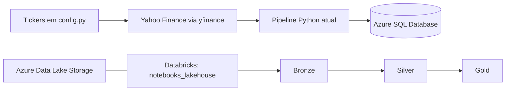

# B3 Lakehouse Project

Projeto de dados da B3 em transicao para uma arquitetura lakehouse no Databricks. O pipeline Python atual extrai cotacoes recentes pelo Yahoo Finance (`yfinance`) e carrega os dados no Azure SQL Database; a pasta `notebooks_lakehouse/` inicia a organizacao das futuras camadas Bronze, Silver e Gold.

## Como funciona



1. `main.py` inicia a extracao para os tickers definidos em `config.py`.
2. `extractor.py` baixa os precos dos ultimos cinco dias e consulta os metadados de cada ativo.
3. `database.py` insere na dimensao apenas tickers que ainda nao existem.
4. As cotacoes sao comparadas com as chaves existentes na tabela fato; apenas as novas sao inseridas.

## Estrutura

```text
b3-lakehouse-project/
├── config.py                 # Variaveis de ambiente e tickers monitorados
├── database.py               # Conexao e persistencia no Azure SQL
├── extractor.py              # Extracao e normalizacao via yfinance
├── main.py                   # Orquestracao do pipeline Python atual
├── notebooks_lakehouse/
│   ├── 01_storage_location.ipynb  # Storage Location e schemas das camadas
│   ├── 02_bronze.ipynb            # Entrada bruta (em desenvolvimento)
│   ├── 03_silver.ipynb            # Tratamento e qualidade (em desenvolvimento)
│   └── 04_gold.ipynb              # Dados analiticos (em desenvolvimento)
├── requirements.txt          # Dependencias Python do pipeline atual
└── README.md
```

## Lakehouse no Databricks

A evolucao planejada organiza os dados em camadas Medallion no Databricks, com armazenamento no Azure Data Lake Storage:

- **Bronze:** persistir os dados de origem com poucas alteracoes, preservando o historico bruto.
- **Silver:** limpar, tipar, validar e deduplicar os dados para consumo confiavel.
- **Gold:** disponibilizar tabelas agregadas ou modeladas para analises de mercado.

Os notebooks estao numerados na ordem sugerida de execucao. No estado atual, `01_storage_location.ipynb` contem comandos SQL iniciais para criar uma External Location e os schemas das tres camadas. O notebook usa valores de exemplo (`training`, `ipca_geral` e `<storage-account>`) que devem ser substituidos e ajustados para o ambiente e os dados da B3. Os notebooks Bronze, Silver e Gold ainda estao vazios; portanto, as transformacoes lakehouse ainda nao foram implementadas. O pipeline Python/Azure SQL descrito neste README permanece independente dessa estrutura inicial.

Para executar os comandos de configuracao, abra o notebook no workspace Databricks com as permissoes necessarias no Unity Catalog. A Storage Credential `main` referenciada no SQL deve existir, e a identidade usada precisa ter acesso ao Azure Data Lake Storage e permissao para criar a External Location e os schemas. Nao versione tokens, chaves ou credenciais no notebook.

## Requisitos

- Python 3.10 ou superior.
- Azure SQL Database acessivel com permissao de leitura e escrita no schema `dbo`.
- ODBC Driver 17 for SQL Server instalado.
- As tabelas `dbo.dim_acao` e `dbo.fato_cotacao_acao` devem existir antes da execucao.

O repositorio nao inclui scripts DDL. O contrato de colunas esperado esta descrito abaixo.

## Configuracao

Crie um arquivo `.env` na raiz do projeto e mantenha credenciais fora do controle de versao:

```env
AZURE_SQL_SERVER=seu-servidor.database.windows.net
AZURE_SQL_DATABASE=nome-do-banco
AZURE_SQL_USER=seu-usuario
AZURE_SQL_PASSWORD=sua-senha
```

Os tickers configurados atualmente sao `PETR4.SA`, `VALE3.SA`, `ITUB4.SA`, `BBDC4.SA` e `ABEV3.SA`. Altere a lista `TICKERS_B3` em `config.py` para incluir ou remover ativos. Use o sufixo `.SA` aceito pelo Yahoo Finance.

## Tabelas esperadas

### `dbo.dim_acao`

| Coluna | Descricao |
| --- | --- |
| `ticker` | Simbolo do ativo, por exemplo `PETR4.SA` |
| `nome_empresa` | Nome longo, nome curto ou ticker como fallback |
| `setor` | Setor informado pelo provedor |
| `industria` | Industria informada pelo provedor |
| `moeda` | Moeda informada pelo provedor; usa `BRL` como fallback |

### `dbo.fato_cotacao_acao`

| Coluna | Descricao |
| --- | --- |
| `ticker` | Simbolo do ativo |
| `preco_abertura` | Preco de abertura |
| `preco_fechamento` | Preco de fechamento |
| `preco_maximo` | Maior preco do dia |
| `preco_minimo` | Menor preco do dia |
| `volume_negociado` | Volume negociado |
| `data_referencia` | Data da cotacao, no formato `YYYY-MM-DD` |

Uma restricao ou indice unico em `(ticker, data_referencia)` na tabela fato e recomendado para reforcar a idempotencia no banco.

## Instalacao e execucao

No PowerShell, a partir da pasta do projeto:

```powershell
python -m venv venv
.\venv\Scripts\Activate.ps1
pip install -r requirements.txt
python main.py
```

O pipeline imprime o andamento da extracao e da carga no terminal. A janela de extracao e definida como `5d` em `main.py`.

## Comportamento e limitacoes

- Os metadados da dimensao sao inseridos apenas para tickers novos; os dados de um ticker existente nao sao atualizados.
- A carga da tabela fato e incremental por `(ticker, data_referencia)`. Uma cotacao ja existente nao e atualizada se o provedor corrigir seus valores posteriormente.
- Falhas ao processar um ticker sao reportadas e a extracao tenta continuar com os demais.
- Se a extracao retornar uma das tabelas vazia, `main.py` encerra a execucao sem carregar nenhuma delas.
- O tratamento de erro principal apenas imprime a excecao; a execucao pode terminar sem codigo de saida diferente de zero mesmo quando o pipeline falha.
- As tabelas sao pre-requisitos: este projeto nao cria nem versiona o schema SQL.

## Tecnologias

- Python 3.10+
- `pandas` e `yfinance`
- `SQLAlchemy` e `pyodbc`
- Azure SQL Database

Os dados dependem da disponibilidade e qualidade do Yahoo Finance. O projeto tem finalidade educacional e de portfolio; valide os requisitos de uso e licenciamento antes de utiliza-lo em producao.
